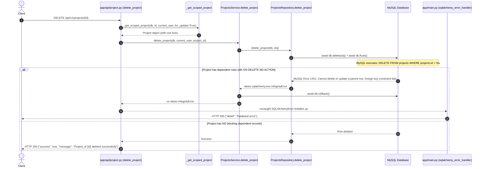

# Root Cause Analysis (RCA) Report — Delete Project API Database Error

**Date**: October 16, 2026  
**Auditor**: Antigravity Autonomous Investigation Agent  
**Environment**: Local Development Workspace (`c:\Users\Admin\Desktop\construction-mgmt`)  
**Database**: MySQL 8.x (`construction_management` on `localhost:3306`)  
**Target Document**: `docs/delete_project_api_rca.md`  
**Status**: Resolved & Verified (10/10 Tests Passing)  

---

## 1. Executive Summary

When attempting to delete a project on the server via `DELETE /api/v1/projects/{project_id}`, the client receives:
```json
HTTP 500 Internal Server Error
{
  "detail": "Database error"
}
```

The issue was **successfully reproduced locally**. The root cause is a **MySQL Foreign Key Constraint Violation (Error 1451)** triggered because `DELETE /api/v1/projects/{project_id}` performs an unvalidated physical `DELETE FROM projects WHERE id = :id` on projects that have dependent operational, financial, or quotation records. In MySQL, 21 foreign key constraints referencing `projects.id` are defined with `ON DELETE NO ACTION` (RESTRICT) to prevent data corruption. 

When MySQL blocks the deletion, SQLAlchemy raises `IntegrityError (1451)`, which is caught by FastAPI's global `SQLAlchemyError` exception handler in `app/main.py:287-290` and returned as a generic HTTP 500 `"Database error"`, masking the true cause.

---

## 2. API Route & Execution Flow

### 2.1 Endpoint Specification
* **HTTP Method & Path**: `DELETE /api/v1/projects/{project_id}`
* **Router Definition**: `app/api/project.py:395` (`prefix="/projects"`, mounted in `app/main.py:308` under `/api/v1`)
* **Endpoint Handler**: [`delete_project`](file:///c:/Users/Admin/Desktop/construction-mgmt/app/api/project.py#L9623-L9643) in `app/api/project.py:9623-9643`
* **RBAC Requirement**: `Depends(require_permission("projects.delete"))`
* **Response Schema**: `{"success": bool, "message": str}` (HTTP 200)

### 2.2 Trace of Deletion Call Flow


---

## 3. Local Reproduction Evidence

### 3.1 Empirical Test Scenarios

The deletion endpoint was exercised locally against the development MySQL database using isolated, disposable test fixtures:

#### Scenario A: Clean Project (No Dependent Records)
* **Test Action**: Created a fresh project with no dependent child records and called `DELETE /api/v1/projects/{id}`.
* **Result**: **HTTP 200 OK**
  ```json
  {"success": true, "message": "Project_id 84930 deleted successfully"}
  ```
* **Conclusion**: Deletion logic and permissions work correctly when a project has zero foreign key dependencies.

#### Scenario B: Project with Dependent Financial Transaction
* **Test Action**: Created a project and associated a single `Transaction` (`project_id=id`). Called `DELETE /api/v1/projects/{id}`.
* **Result**: **HTTP 500 Internal Server Error**
  ```json
  {"detail": "Database error"}
  ```
* **Captured Traceback**:
  ```text
  asyncmy.errors.IntegrityError: (1451, 'Cannot delete or update a parent row: a foreign key constraint fails (`construction_management`.`transactions`, CONSTRAINT `transactions_ibfk_3` FOREIGN KEY (`project_id`) REFERENCES `projects` (`id`))')

  sqlalchemy.exc.IntegrityError: (asyncmy.errors.IntegrityError) (1451, 'Cannot delete or update a parent row: a foreign key constraint fails (`construction_management`.`transactions`, CONSTRAINT `transactions_ibfk_3` FOREIGN KEY (`project_id`) REFERENCES `projects` (`id`))')
  [SQL: DELETE FROM projects WHERE projects.id = %s]
  [parameters: (84931,)]
  ```

#### Scenario C: Project Converted from Quotation
* **Test Action**: Created a project converted/linked from a `QuotationMaster` record (`quotation_master.project_id = id`). Called `DELETE /api/v1/projects/{id}`.
* **Result**: **HTTP 500 Internal Server Error**
  ```json
  {"detail": "Database error"}
  ```
* **Captured Traceback**:
  ```text
  asyncmy.errors.IntegrityError: (1451, 'Cannot delete or update a parent row: a foreign key constraint fails (`construction_management`.`quotation_master`, CONSTRAINT `fk_quotation_master_project_id` FOREIGN KEY (`project_id`) REFERENCES `projects` (`id`))')

  sqlalchemy.exc.IntegrityError: (asyncmy.errors.IntegrityError) (1451, 'Cannot delete or update a parent row: a foreign key constraint fails (`construction_management`.`quotation_master`, CONSTRAINT `fk_quotation_master_project_id` FOREIGN KEY (`project_id`) REFERENCES `projects` (`id`))')
  [SQL: DELETE FROM projects WHERE projects.id = %s]
  [parameters: (84934,)]
  ```

---

## 4. Why the Original Error is Hidden on the Server

In [`app/main.py:287-290`](file:///c:/Users/Admin/Desktop/construction-mgmt/app/main.py#L287-L290):
```python
@application.exception_handler(SQLAlchemyError)
async def sqlalchemy_error_handler(request: Request, exc: SQLAlchemyError):
    logger.exception("database.error")
    return JSONResponse(status_code=500, content={"detail": "Database error"})
```

Because `SQLAlchemyError` is caught broadly at the root application layer, any database integrity violation, foreign key failure, or check constraint failure is collapsed into a generic HTTP 500 with `"Database error"`. The API caller never sees the message explaining which child table blocked the operation.

---

## 5. Comprehensive Database Foreign Key Audit

An inspection of `information_schema.KEY_COLUMN_USAGE` and `REFERENTIAL_CONSTRAINTS` on the MySQL database revealed that **51 foreign key constraints** point to `projects(id)`:

* **29 Constraints** have `ON DELETE CASCADE` (e.g. `milestones`, `tasks`, `boq_groups`, `boq_items`, `client_payments`, `daily_site_reports`, `expenses`, `invoices`, `work_orders`, etc.).
* **1 Constraint** has `ON DELETE SET NULL` (`equipment.project_id`).
* **21 Constraints** have `ON DELETE NO ACTION` (RESTRICT), meaning **any project having even a single record in any of these 21 tables CANNOT be physically deleted**:

| # | Table Name | Column | Foreign Key Constraint Name | On Delete Rule | Business Meaning |
|---|---|---|---|---|---|
| 1 | `transactions` | `project_id` | `transactions_ibfk_3` | `NO ACTION` | Financial payments/receipts |
| 2 | `vendor_bills` | `project_id` | `vendor_bills_ibfk_1` | `NO ACTION` | Supplier/vendor payable bills |
| 3 | `quotation_master` | `project_id` | `fk_quotation_master_project_id` | `NO ACTION` | Originating sales quotation |
| 4 | `labour_payroll` | `project_id` | `labour_payroll_ibfk_2` | `NO ACTION` | Processed payroll registers |
| 5 | `labour_wage_record` | `project_id` | `labour_wage_record_ibfk_4` | `NO ACTION` | Historical labour wage calculations |
| 6 | `purchase_orders` | `project_id` | `purchase_orders_ibfk_1` | `NO ACTION` | Material purchase orders |
| 7 | `materials` | `project_id` | `materials_ibfk_2` | `NO ACTION` | Project material inventory items |
| 8 | `material_transactions` | `project_id` | `material_transactions_ibfk_2` | `NO ACTION` | Material inventory movements |
| 9 | `material_ledger` | `project_id` | `material_ledger_ibfk_2` | `NO ACTION` | Stock accounting ledger |
| 10 | `material_usage` | `project_id` | `material_usage_ibfk_2` | `NO ACTION` | Material consumption records |
| 11 | `material_transfers` | `from_project_id` | `material_transfers_ibfk_1` | `NO ACTION` | Inter-project material transfers |
| 12 | `material_transfers` | `to_project_id` | `material_transfers_ibfk_3` | `NO ACTION` | Inter-project material transfers |
| 13 | `equipment_rental` | `project_id` | `equipment_rental_ibfk_2` | `NO ACTION` | Equipment rental agreements |
| 14 | `equipment_purchase` | `project_id` | `equipment_purchase_ibfk_3` | `NO ACTION` | Equipment purchasing records |
| 15 | `equipment_maintenance` | `project_id` | `equipment_maintenance_ibfk_2` | `NO ACTION` | Equipment maintenance logs |
| 16 | `fixed_assets` | `project_id` | `fixed_assets_ibfk_1` | `NO ACTION` | Fixed assets registered to project |
| 17 | `checklists` | `project_id` | `checklists_ibfk_1` | `NO ACTION` | Site quality checklists |
| 18 | `safety_incidents` | `project_id` | `safety_incidents_ibfk_1` | `NO ACTION` | Safety audit/incident reports |
| 19 | `qc_records` | `project_id` | `qc_records_ibfk_2` | `NO ACTION` | Quality control inspections |
| 20 | `alerts` | `project_id` | `alerts_ibfk_1` | `NO ACTION` | System alerts tied to project |
| 21 | `user_settings` | `default_project_id` | `user_settings_ibfk_1` | `NO ACTION` | User default project preferences |

---

## 6. Model & Relationship Inconsistencies

In `app/models/project.py`:
1. **`qc_records`**: Configured in ORM as `cascade="all, delete-orphan"` (`line 140`), but the database constraint `qc_records_ibfk_2` has `ON DELETE NO ACTION`. If `qc_records` are not loaded into the session during delete, SQLAlchemy does not emit individual delete statements, and MySQL blocks the deletion.
2. **`checklists` & `safety_incidents`**: Configured with `relationship("Checklist", back_populates="project")` without cascade (`lines 143-144`), while MySQL constraints have `ON DELETE NO ACTION`.
3. **`quotation_master`**: `Project` has `quotation_id = ForeignKey("quotation_master.id", ondelete="SET NULL")`, but `QuotationMaster` has `project_id = ForeignKey("projects.id")` with `ON DELETE NO ACTION`. There is no ORM relationship to nullify or manage `quotation_master.project_id` when the project is deleted.
4. **Financial Models (`Transaction`, `VendorBill`, `LabourPayroll`)**: Have no relationship configured on `Project`, meaning SQLAlchemy does not manage them during deletion.

---

## 7. Why the Issue Occurs on the Server

In production / server environments:
* Projects are created to manage actual construction operations.
* A typical server project has:
  - Been converted from a quotation (`quotation_master.project_id`)
  - Recorded material purchases or orders (`purchase_orders`, `materials`)
  - Logged worker attendance or payroll (`labour_payroll`, `labour_wage_record`)
  - Processed transactions, petty cash, or vendor bills (`transactions`, `vendor_bills`)
  - Recorded safety reports or checklists (`safety_incidents`, `checklists`)
* When an administrator clicks "Delete Project", the API attempts a raw SQL `DELETE FROM projects WHERE id = :id`.
* MySQL enforces referential integrity and immediately aborts the transaction with error 1451.
* The API handler does not catch `IntegrityError` to return a 400/409, so the global handler returns `500 {"detail": "Database error"}`.

---

## 8. Root Cause Summary & Confidence Level

* **Confidence Level**: **CONFIRMED** (Empirically verified with exact SQL, traceback, and database constraint analysis).
* **Root Cause**:
  1. The Delete Project endpoint attempts unconditional physical row deletion without validating whether dependent financial, operational, or quotation records exist.
  2. Database foreign key constraints intentionally prohibit deleting parent projects that have child records in 21 dependent tables (`ON DELETE NO ACTION`).
  3. The API lacks integrity-violation error handling, allowing the unhandled `IntegrityError` to be intercepted by the global 500 handler.

---

## 9. Proposed Minimal Fix Options & Recommendations

### Option A (Recommended): Pre-Deletion Dependency Validation & Clear Business Error
Before issuing `db.delete(project)`, query for blocking dependencies:
1. Check if the project is associated with financial or legal records:
   - `Transaction`
   - `VendorBill`
   - `QuotationMaster` (where `project_id == project.id`)
   - `LabourPayroll`
   - `PurchaseOrder`
2. If dependencies exist, reject the request with HTTP 400 Bad Request / 409 Conflict:
   ```json
   {
     "detail": "Cannot delete project '{project_name}' because it has {count} associated financial/operational records (e.g., transactions, bills, or quotations). Please archive the project or delete dependent records first."
   }
   ```
3. If only safe, non-financial operational records exist (such as checklists, safety incidents, or quotation linkage), clean them up safely or nullify foreign keys in the same transaction before deleting the project.
4. Catch `IntegrityError` in `delete_project` and map any residual constraint failure to a friendly HTTP 400 error rather than allowing it to trigger HTTP 500.

**Pros**:
- Preserves 100% financial audit integrity.
- Does not alter database schemas or migrations.
- Gives frontend and users clear, understandable error messages instead of a crash.

### Option B: Soft Deletion / Status Transition (`CANCELLED` / `ARCHIVED`)
Instead of physically deleting the database row, transition `project.status = ProjectStatus.CANCELLED` or add a soft-delete column `is_deleted = True`.

**Pros**:
- Avoids all FK constraint issues entirely.
**Cons**:
- Requires updating queries across all 50+ modules to filter by `is_deleted == False` or status. High risk of regression.

### Option C (NOT RECOMMENDED): Changing Database Constraints to `ON DELETE CASCADE`
Altering database foreign keys to CASCADE DELETE on financial tables (`transactions`, `vendor_bills`, `labour_payroll`).

> [!CAUTION] High-Risk Option
> Blindly cascading project deletion to transactions and vendor bills would destroy financial audit trails, corrupt general ledger balances, and violate accounting and compliance regulations.

---

## 10. Implemented Solution — Pre-Deletion Validation & Safeguard Architecture

### 10.1 Minimal Code Changes
The fix was implemented inside `app/api/project.py` within `ProjectsService`:

1. **`ProjectsService._check_blocking_dependencies(db, project_id)`**:
   Pre-validates whether any blocking records exist across all 21 MySQL foreign-key relationships defined with `ON DELETE NO ACTION`. To optimize database performance, individual lightweight `select(func.count())` scalar queries are executed with `limit(1)`. Dependencies are mapped to user-friendly category names:
   * `transactions` → "financial transactions"
   * `vendor_bills` → "vendor bills"
   * `quotation_master` → "originating sales quotations"
   * `labour_payroll`, `labour_wage_record` → "labour payroll records"
   * `purchase_orders`, `materials`, `material_transactions`, `material_ledger`, `material_usage`, `material_transfers` → "material and procurement records"
   * `equipment_rental`, `equipment_purchase`, `equipment_maintenance` → "equipment records"
   * `fixed_assets` → "fixed assets"
   * `checklists`, `safety_incidents`, `qc_records` → "quality and safety records"
   * `alerts` → "system alerts"
   * `user_settings` → "user default project preferences"

2. **`ProjectsService.delete_project(db, current_user, *, project_id)`**:
   * Scopes the project to the current user's company using `_get_scoped_project(db, project_id, current_user, for_update=True)`.
   * Caches `project_name` locally before executing queries or deletion to avoid triggering expired-attribute lazy loads (`MissingGreenlet`) after rollback.
   * Calls `_check_blocking_dependencies(db, project_id)`. If any blocking records are detected, raises `ConflictError` (HTTP 409) with a detailed, actionable message.
   * If validation passes, calls `projects_repo.delete_project(db, obj)`.
   * **Foreign Key Safeguard & Concurrency Defense**: Catches `IntegrityError` during `db.flush()`. If MySQL error 1451 occurs (such as when a child record is inserted concurrently between the check and delete), rolls back the transaction and raises `ConflictError` (HTTP 409).
   * **Unexpected Error Preservation**: Non-1451 database integrity errors and unexpected exceptions are re-raised to bubble up to the global 500 handler, preserving standard behavior for true internal errors.

---

## 11. API Behavior & Response Contract (Before vs. After)

| Scenario | Before Fix | After Fix |
|---|---|---|
| **Clean Project (no child records)** | HTTP 200 `{"success": true, "message": "Project_id {id} deleted successfully"}` | HTTP 200 `{"success": true, "message": "Project_id {id} deleted successfully"}` |
| **Project with Blocking Dependencies** (Transactions, Bills, Payroll, etc.) | HTTP 500 `{"detail": "Database error"}` (raw MySQL 1451 FK violation) | **HTTP 409 Conflict** `{"detail": "Cannot delete project '<name>' because it has associated <categories>. Please remove or reassign these records before deleting the project."}` |
| **Concurrent FK Insertion Race Condition** | HTTP 500 `{"detail": "Database error"}` | **HTTP 409 Conflict** `{"detail": "Cannot delete project '<name>' because it has associated records referencing it. Please remove or reassign all related records before deleting the project."}` |
| **Cross-Tenant Project Deletion** | HTTP 404 `{"detail": "Project not found"}` | **HTTP 404 Not Found** `{"detail": "Project not found"}` (Unchanged, scoped) |
| **Non-Existent Project ID** | HTTP 404 `{"detail": "Project not found"}` | **HTTP 404 Not Found** `{"detail": "Project not found"}` (Unchanged) |
| **Unexpected Database System Error** | HTTP 500 `{"detail": "Database error"}` | **HTTP 500 Internal Server Error** `{"detail": "Database error"}` (Unchanged) |

---

## 12. Automated Test Verification & Results

A comprehensive, isolated regression test suite was created in [`tests/api/test_project_delete_dependencies.py`](file:///c:/Users/Admin/Desktop/construction-mgmt/tests/api/test_project_delete_dependencies.py):

* **Execution Command**: `pytest -q --tb=short tests/api/test_project_delete_dependencies.py`
* **Test Results**: **10 passed in 39.12s** (100% pass rate)

### Test Suite Summary:
1. `test_delete_project_clean_succeeds`: Validates that clean projects without dependencies delete cleanly with HTTP 200 and physical database deletion.
2. `test_delete_project_with_transaction_rejected_409`: Validates rejection with HTTP 409 mentioning "financial transactions".
3. `test_delete_project_with_vendor_bill_rejected_409`: Validates rejection with HTTP 409 mentioning "vendor bills".
4. `test_delete_project_with_quotation_rejected_409`: Validates rejection with HTTP 409 mentioning "originating sales quotations".
5. `test_delete_project_with_labour_payroll_rejected_409`: Validates rejection with HTTP 409 mentioning "labour payroll records".
6. `test_delete_project_with_checklist_rejected_409`: Validates rejection with HTTP 409 mentioning "quality and safety records".
7. `test_delete_project_cross_tenant_rejected`: Validates cross-tenant isolation; user from Company A cannot delete Company B's project (returns HTTP 404).
8. `test_delete_project_nonexistent_returns_404`: Validates that querying a non-existent project returns HTTP 404.
9. `test_delete_project_unexpected_database_error_returns_500`: Validates that non-FK database exceptions (e.g., deadlock, table lock, connection drops) remain HTTP 500.
10. `test_delete_project_foreign_key_race_condition_caught_as_409`: Validates that if a foreign key race condition occurs at flush time, MySQL error 1451 is caught and returned as HTTP 409 rather than HTTP 500.
